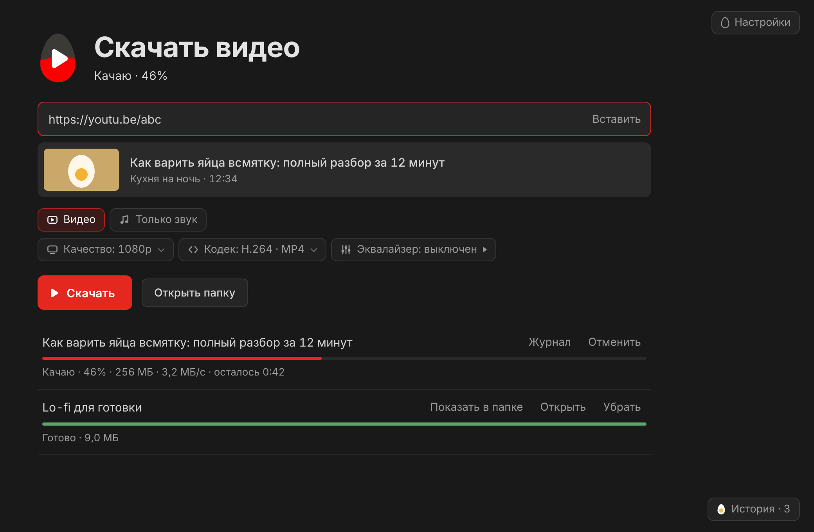

<p align="center"></p>
<h1 align="center">Яйцатюб</h1>
<p align="center">Загрузчик видео и звука для Windows с эквалайзером. <a href="#english">English below</a>.</p>



## Что умеет

- Качает видео с YouTube и других сайтов, которые поддерживает [yt-dlp](https://github.com/yt-dlp/yt-dlp).
- Видео: качество от 480p до максимума; кодеки H.264, H.265, AV1 (MP4), VP9 (WebM), ProRes (MOV).
  H.265 и ProRes перекодируются на компьютере через ffmpeg.
- Только звук: MP3, M4A, Opus, FLAC, WAV.
- Эквалайзер для звука и для звуковой дорожки видео: десять полос или график с точками
  (колокол, полки, срезы с крутизной 12–48 дБ/окт). Кривая на графике считается теми же формулами, что и фильтры ffmpeg.
- Предпрослушивание: полминуты звука по ссылке, эквалайзер накладывается на лету.
- Карточка видео под ссылкой, очередь загрузок, история, докачка после обрыва связи.
- Тёмная и светлая тема, русский и английский язык, сворачивание в трей.

## Установка

Скачай `Yaytsatube-Setup.exe` со страницы [Releases](../../releases) и запусти. Программа ставится в
`%LOCALAPPDATA%\Programs\Yaytsatube` без прав администратора и удаляется через «Установленные приложения».
При первом запуске она сама докачивает yt-dlp, ffmpeg и deno с GitHub. Windows покажет предупреждение о неизвестном
издателе: exe не подписан.

## Запуск из исходников

```
pip install -r requirements.txt
python app/eggtube.py
```

Нужны Windows 10 или 11 и Python 3.12+. Сборка в один exe: `build.bat` (PyInstaller).

## Как устроено

| Путь | Что там |
|---|---|
| `app/eggtube.py` | программа: очередь, запуск yt-dlp и ffmpeg, эквалайзер, установка, трей |
| `app/ui.html` | весь интерфейс одним файлом (pywebview) |
| `tools/icon.py` | рисует иконку |
| `tools/build.py`, `tools/pe.py` | запасной способ сборки без Windows: пересадка кода в готовый exe PyInstaller |
| `test/run.py` | проверки логики с подставным yt-dlp (`test/fake_ytdlp.py`), нужен ffmpeg |
| `test/ffcheck.py` | сверка формул эквалайзера с настоящим ffmpeg |
| `test/shot.py` | проверки интерфейса в браузере (Playwright) |
| `test/win_sim.py` | установка и трей с подменёнными вызовами Windows |

## Важно

Скачивай только то, на что у тебя есть права. Программа не связана с YouTube и Google. Сами yt-dlp, ffmpeg и deno
не входят в репозиторий и распространяются по своим лицензиям.

Лицензия: [MIT](LICENSE). Автор: owori.

---

<a name="english"></a>
## English

Yaytsatube is a Windows video and audio downloader with a built-in equalizer, powered by
[yt-dlp](https://github.com/yt-dlp/yt-dlp) and ffmpeg.


- Video up to the maximum available quality in H.264, H.265, AV1 (MP4), VP9 (WebM) or ProRes (MOV);
  audio as MP3, M4A, Opus, FLAC or WAV.
- Ten-band or graphical parametric equalizer (bell, shelves, cuts at 12–48 dB/oct) for audio and for the audio track
  of a video, with a live preview of a 30-second clip.
- Queue, history, automatic resume after connection drops, dark and light themes, Russian and English, tray icon.

**Install:** download `Yaytsatube-Setup.exe` from [Releases](../../releases) and run it. No admin rights needed;
yt-dlp, ffmpeg and deno are fetched from GitHub on first start. The exe is unsigned, so Windows will warn about an
unknown publisher.

**Run from source:** `pip install -r requirements.txt`, then `python app/eggtube.py` (Windows 10/11, Python 3.12+).
Build a single exe with `build.bat`.

Download only what you have the rights to. Not affiliated with YouTube or Google. Licensed under [MIT](LICENSE).
