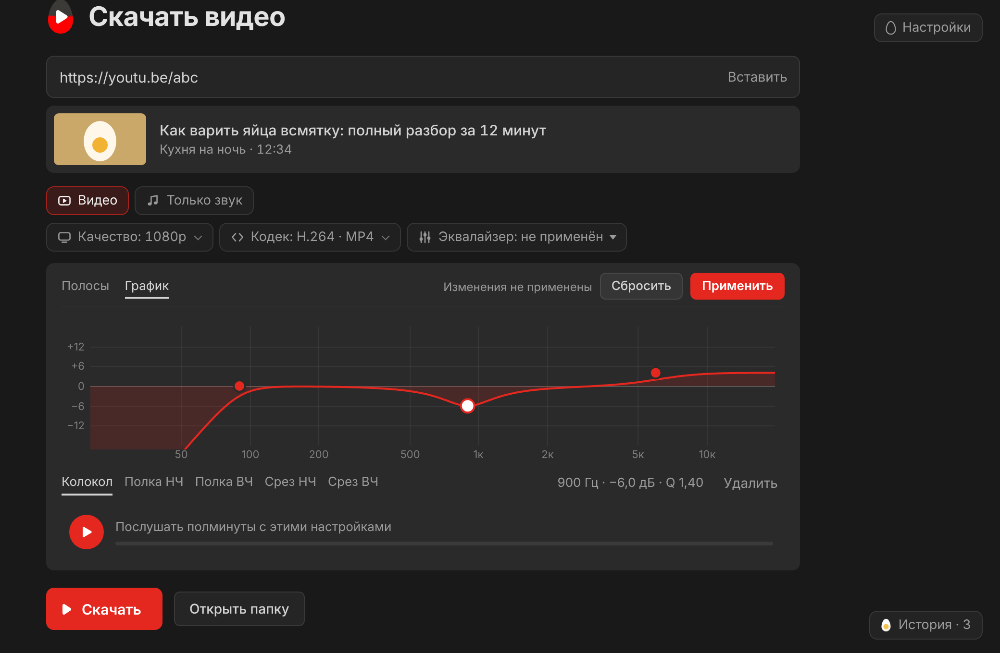

<div align="center">


# Яйцатюб

Загрузчик видео и звука для Windows с эквалайзером

### [⬇ Скачать последнюю версию](../../releases/latest/download/Yaytsatube-Setup.exe)

<sub>[English below](#english)</sub>

</div>


> [!IMPORTANT]
> Программа не связана с YouTube и Google. Скачивай только то, на что у тебя есть права.

## Использование

1. Скачай [`Yaytsatube-Setup.exe`](../../releases/latest/download/Yaytsatube-Setup.exe) (или открой страницу [последнего релиза](../../releases/latest)).
2. Запусти файл и ответь «Да» на вопрос об установке. Права администратора не нужны.
3. Программа откроется сама. При первом запуске она докачает компоненты (yt-dlp, ffmpeg, deno), это около 300 МБ.
4. Вставь ссылку на видео, выбери качество и кодек, нажми «Скачать».

После установки ярлыки лежат на рабочем столе и в меню «Пуск», сам установщик можно удалить.

Обновляется программа сама: Настройки → «Проверить обновления». Заново скачивать и ставить ничего не нужно.

> [!WARNING]
> Файл не подписан, поэтому Windows покажет «Система Windows защитила ваш компьютер». Нажми «Подробнее», затем
> «Выполнить в любом случае». Некоторые антивирусы настороженно относятся к неподписанным программам, собранным
> PyInstaller: исходный код открыт, проверить и собрать программу можно самому.

## Что умеет

- **Видео и музыка** с YouTube, SoundCloud и других сайтов, которые поддерживает [yt-dlp](https://github.com/yt-dlp/yt-dlp): видео от 480p до максимума.
- **Кодеки видео:** H.264, H.265 и AV1 в MP4, VP9 в WebM, ProRes в MOV (профили Proxy, LT, 422, 422 HQ, 4444). H.265 и ProRes перекодируются на компьютере.
- **Только звук:** MP3, M4A, Opus, FLAC, WAV.
- **Эквалайзер** для звука и для звуковой дорожки видео: десять полос или график с точками
  (колокол, полки, срезы с крутизной 12–48 дБ/окт).
- **Предпрослушивание:** полминуты звука по ссылке, эквалайзер слышно сразу.
- **Отрывок:** можно скачать не всё видео или трек, а кусок от и до по времени.
- Карточка видео под ссылкой, очередь, история, докачка после обрыва связи.
- Тёмная и светлая тема, русский и английский язык, окно любой формы, работа в трее, обновление из программы.



## Распространённые вопросы

### Долго «Подключаюсь к серверу» или качает медленно

Под строкой загрузки серым написано, что отвечает yt-dlp, а кнопка «Журнал» открывает полный лог. Если YouTube у тебя
замедлен, поможет VPN на весь компьютер или прокси в настройках программы.

### Ошибка «YouTube отказал в выдаче файла» (403)

У YouTube так бывает временно. Нажми «Повторить» чуть позже; если повторяется, в настройках нажми «Обновить» у компонентов.

### В настройках написано «нет: yt-dlp, ffmpeg, deno»

Компоненты не скачались с GitHub. Под списком настроек видна причина. Проверь интернет и нажми «Обновить»; если
GitHub у тебя не открывается, укажи прокси в настройках, загрузка пойдёт через него. Уже установленные в системе
ffmpeg, yt-dlp и deno программа находит сама.

### Можно ли качать со Spotify

Нет: музыка там защищена. Найди этот трек на YouTube или YouTube Music и вставь ссылку оттуда; SoundCloud тоже качается.

### Закрыл окно, а программа не закрылась

По умолчанию крестик прячет окно в трей, чтобы загрузки шли дальше. Выйти можно через значок у часов; поведение
меняется в настройках, строка «При закрытии».

### H.265 или ProRes готовятся очень долго

Сайты эти кодеки обычно не отдают, поэтому программа качает лучшее, что есть, и перекодирует сама. ProRes ещё и очень
большой: примерно гигабайт за минуту в 1080p.

### Как обновить или удалить

Обновление: Настройки → «Проверить обновления», программа обновится сама и перезапустится.
Удаление: «Параметры» → «Приложения» → «Установленные приложения» → «Яйцатюб». Скачанные видео останутся.

## Запуск из исходников

```
pip install -r requirements.txt
python app/eggtube.py
```

Нужны Windows 10 или 11 и Python 3.12+. Сборка в один exe: `build.bat` (PyInstaller).

| Путь | Что там |
|---|---|
| `app/eggtube.py` | программа: очередь, запуск yt-dlp и ffmpeg, эквалайзер, установка, трей |
| `app/ui.html` | весь интерфейс одним файлом (pywebview) |
| `tools/` | иконка и запасной способ сборки |
| `test/` | проверки логики, формул эквалайзера, интерфейса и установки |

## Лицензирование

Проект распространяется на условиях лицензии [MIT](LICENSE). Автор: owori.
yt-dlp, ffmpeg и deno не входят в репозиторий и распространяются по своим лицензиям.

---

<a name="english"></a>
## English

Yaytsatube is a Windows video and audio downloader with a built-in equalizer, powered by
[yt-dlp](https://github.com/yt-dlp/yt-dlp) and ffmpeg.

**[⬇ Download the latest release](../../releases/latest/download/Yaytsatube-Setup.exe)**: run `Yaytsatube-Setup.exe` and answer Yes. Later updates
install from inside the app (Settings → Check for updates). No admin
rights needed; yt-dlp, ffmpeg and deno (about 300 MB) are fetched on first start. The file is unsigned, so Windows
SmartScreen will warn: choose "More info", then "Run anyway".

- Video up to the maximum available quality in H.264, H.265, AV1 (MP4), VP9 (WebM) or ProRes (MOV);
  audio as MP3, M4A, Opus, FLAC or WAV.
- Ten-band or graphical parametric equalizer for audio and for the audio track of a video, with a live preview.
- Queue, history, automatic resume after connection drops, dark and light themes, Russian and English, tray icon.

Run from source: `pip install -r requirements.txt`, then `python app/eggtube.py` (Windows 10/11, Python 3.12+).

Download only what you have the rights to. Not affiliated with YouTube or Google. Licensed under [MIT](LICENSE).
